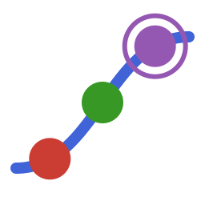

# ConditionalLogit.jl



[](https://simoneSantoni.github.io/ConditionalLogit.jl/dev/)
[](https://julialang.org/)
[](https://opensource.org/licenses/MIT)

Conditional logit models in Julia. The package fits conditional logistic regression
(matched case–control sets, fixed-effects logit, McFadden's choice model) by **exact
conditional maximum likelihood**. It is written so that published results can be
reproduced from a sentence such as

> We estimated the conditional logit model by maximum likelihood using PROC LOGISTIC in
> SAS (release 9.3).

That means SAS `PROC LOGISTIC` with a `STRATA` statement. The package has the same
likelihood, starting values, Newton–Raphson convergence rule, fit statistics, global
tests, Wald inference and odds-ratio tables, and prints them in a SAS-like layout. It
is validated against the SAS documentation example and against R's
`survival::clogit(method = "exact")`.

## Installation

```julia
using Pkg
Pkg.add(url = "https://github.com/simoneSantoni/ConditionalLogit.jl")   # or Pkg.develop(path = "...")
```

Julia ≥ 1.10.

The full documentation, with a tutorial and the API reference, is at
<https://simoneSantoni.github.io/ConditionalLogit.jl/dev/>.

## Quick start

```julia
using ConditionalLogit, CSV, DataFrames

# SAS/STAT example LOGIEX11: 63 matched pairs (Los Angeles endometrial cancer study)
la = CSV.read(pkgdir(ConditionalLogit, "test", "reference", "la.csv"), DataFrame)
# columns s (pair id), y, gall, hyper
m  = clogit(@formula(y ~ gall), la; strata = :s)
```

```
Model Fit Statistics
─────────────┬───────────────────────────
             │     Without         With
  Criterion  │  Covariates   Covariates
─────────────┼───────────────────────────
  AIC        │      87.337       85.654
  SC         │      87.337       88.490
  -2 Log L   │      87.337       83.654
─────────────┴───────────────────────────

Testing Global Null Hypothesis: BETA=0
────────────────────┬────────────────────────────────
  Test              │  Chi-Square   DF   Pr > ChiSq
────────────────────┼────────────────────────────────
  Likelihood Ratio  │      3.6830    1       0.0550
  Score             │      3.5556    1       0.0593
  Wald              │      3.2970    1       0.0694
────────────────────┴────────────────────────────────

Analysis of Conditional Maximum Likelihood Estimates
─────────────┬──────────────────────────────────────────────────────
             │                  Standard         Wald
  Parameter  │  DF   Estimate      Error   Chi-Square   Pr > ChiSq
─────────────┼──────────────────────────────────────────────────────
  gall       │   1     0.9555     0.5262       3.2970       0.0694
─────────────┴──────────────────────────────────────────────────────

Odds Ratio Estimates
──────────┬──────────────────────────────────
          │     Point     95% Wald
  Effect  │  Estimate   Confidence   Limits
──────────┼──────────────────────────────────
  gall    │     2.600        0.927    7.293
──────────┴──────────────────────────────────
```

Every number above is identical to the SAS output printed in the SAS/STAT
documentation for this example. The full display also shows Model Information, the
Strata Summary and the convergence status.

Other entry points:

```julia
fit(ConditionalLogitModel, @formula(case ~ spontaneous + induced), infert; strata = :stratum)
fit(ConditionalLogitModel, f, df, :id)     # strata may also be passed positionally
clogit(X, y, strata)                       # matrix interface (no intercept column)
clogit(X, y; strata = s)                   # ... with strata as a keyword
clogit(f, df; strata = [:hospital, :set])  # several columns form the stratum key (SAS: strata a b;)
clogit(f, df; strata = :id, freq = :n)     # SAS FREQ
clogit(f, df; strata = :id, offset = :o)   # SAS OFFSET=
```

There is no intercept: it is conditioned out together with the strata. `y ~ x` and
`y ~ 0 + x` are the same model, and `y ~ 1 + x` is an error. Categorical covariates get
full-rank (k − 1) contrasts. The data can be any Tables.jl table (DataFrame,
`CSV.File`, a `NamedTuple` of vectors, ...).

### Keywords

| keyword | default | meaning |
|---|---|---|
| `strata` | required | column name(s) or vector of stratum ids |
| `event` | `true` / `1` | response level modelled as the event (required for non-0/1 responses) |
| `freq` / `weights = fweights(v)` | none | frequency of each row (SAS FREQ) |
| `offset` | none | offset column or vector |
| `contrasts` | `Dict()` | StatsModels contrasts for categorical covariates |
| `strata_missing` | `false` | treat a missing stratum id as a stratum (SAS `STRATA / MISSING`) |
| `maxiter` | 25 | SAS `MAXITER=` |
| `gconv` | 1e-8 | SAS `GCONV=` (relative gradient criterion) |
| `fconv`, `absfconv`, `xconv` | off | SAS `FCONV=`, `ABSFCONV=`, `XCONV=` |
| `maxstephalving` | 50 | maximum step-halvings when a Newton step lowers ℓ |
| `singular` | `1e7 * eps()` ≈ 2.2e-9 | tolerance of the collinearity sweep (the SAS `SINGULAR=` default) |
| `dropcollinear` | `true` | set aliased coefficients to 0 (otherwise error) |
| `sc_n` | `:informative` | `n` used in SC/BIC (see below) |
| `start` | zeros | starting values (finite; replaced by 0, with a warning, if ℓ(start) < ℓ(0)) |
| `ntasks` | `Threads.nthreads()` | tasks used for the per-stratum work (≥ 1; results are bitwise identical for any value) |
| `strict` | `false` | throw instead of warn on non-convergence or separation |
| `verbose` | `false` | print the iteration history |

### Results

| SAS output | Julia |
|---|---|
| Model Information / Number of Observations Read, Used | `show(m)`, `m.nobs_read`, `m.nobs_used`, `m.freq_used` |
| Strata Summary | `stratasummary(m)` |
| Convergence Status | `converged(m)`, `convergencestatus(m)`, `iterations(m)`, `iterationhistory(m)` |
| Model Fit Statistics: -2 Log L (Without / With Covariates) | `nulldeviance(m)` / `deviance(m)`, i.e. `-2nullloglikelihood(m)` / `-2loglikelihood(m)` |
| Model Fit Statistics: AIC, SC | `aic(m)`, `bic(m)`; both columns in `fitstatistics(m)` |
| Testing Global Null Hypothesis: BETA=0 | `globaltests(m)` (`.lr`, `.score`, `.wald`, each `(chisq, df, pvalue)`) |
| Analysis of (Conditional) Maximum Likelihood Estimates | `coef(m)`, `stderror(m)`; Wald χ² = `(coef(m) ./ stderror(m)).^2`; `coeftable(m)` |
| Odds Ratio Estimates (Wald CL) | `oddsratios(m; level = 0.95)`; general contrasts: `oddsratio(m, c)` |
| COVB / Wald CL for parameters | `vcov(m)`, `confint(m)` |
| Likelihood ratio test of nested models (−2 Log L difference) | `StatsModels.lrtest(m1, m2)` |

`stratasummary`, `fitstatistics`, `globaltests` and `oddsratios` return Tables.jl
tables, so `DataFrame(oddsratios(m))` works. `iterationhistory(m)[k].beta` has one
entry per coefficient (0 for aliased ones). `fitted(m)` returns the within-stratum
probability that each observation is an event (the softmax when there is one event per
stratum); it is computed on first use, so fitting does not pay for it.
`predict(m, newdata; strata)` gives within-stratum choice probabilities for new choice
sets (one event per stratum), and `type = :linpred` gives x'β̂. With `strict = true`,
non-convergence and separation throw a `ConvergenceError`.

Fits can run concurrently, e.g. a bootstrap inside `Threads.@threads` or many models
with `Threads.@spawn`.

## Matching SAS PROC LOGISTIC

**Which model.** `PROC LOGISTIC` with a `STRATA` statement maximises the exact
conditional likelihood

L_k(β) = exp(Σ_{i∈events} x_i'β) / Σ_{S ⊂ stratum k, |S| = m_k} exp(Σ_{j∈S} x_j'β)

for any number of events m_k per stratum. It does not use the Breslow or Efron
approximation. This is also what R `survival::clogit(method = "exact")` and Stata
`clogit` compute. This package computes the same likelihood with no approximation.
(R's `clogit` *default* is `method = "exact"`, but `coxph`-based code that uses
Breslow or Efron ties gives different numbers when m_k > 1.)

**Response ordering: check the signs.** By default SAS models the probability of the
*lower* ordered response value. For a 0/1 outcome that is `Y = 0`, unless the code says
`model y(event='1') = ...` or `model y(descending) = ...`.

| SAS code | Julia |
|---|---|
| `model y(event='1') = x;` or `model y(descending) = x;` | `clogit(@formula(y ~ x), df; strata = :id)` (default) |
| `model y = x;` with y coded 0/1 | `clogit(@formula(y ~ x), df; strata = :id, event = 0)` |
| `model status(event='case') = x;` | `clogit(@formula(status ~ x), df; strata = :id, event = "case")` |

Changing the event level negates every coefficient (β → −β) and inverts every odds
ratio. Standard errors, Wald χ², p-values, −2 Log L, AIC, SC and all three global
tests are unchanged. If a paper's code shows no `EVENT='1'` or `DESCENDING`, negate
the published estimates (or invert its odds ratios) before comparing, or fit with
`event = 0`. With an offset, a flipped model is not a pure sign flip. For character
responses SAS orders the levels alphabetically (formatted values).

**CLASS variables.** SAS `PROC LOGISTIC` defaults to `PARAM=EFFECT` (deviation coding)
with the *last* level as reference. StatsModels defaults to dummy coding with the
*first* level as base. To reproduce the SAS parameter table, pass
`contrasts = Dict(:g => EffectsCoding(base = "<last level>"))`. For `PARAM=REF`, pass
`DummyCoding(base = "<last level>")`. You will need `using StatsModels`. `oddsratios(m)`
reports level-versus-reference odds ratios computed from the contrast matrix, so they
match SAS under either coding. Under effect coding, `exp(β)` is *not* an odds ratio.

**Convergence.** As in SAS, the fit:
- starts at β = 0;
- uses Newton–Raphson;
- stops when the relative gradient criterion g'I⁻¹g / (|ℓ| + 1e-6) < `gconv` = 1e-8;
- *reports that iterate*, without taking one more step.

The reported estimates can therefore differ from the exact optimum in about the 6th
significant digit. SAS prints 4 decimals, so this does not show. For full accuracy,
pass `gconv = 1e-16`. Non-convergence after `maxiter = 25` iterations, and complete or
quasi-complete separation, give a warning and `converged(m) == false`, as SAS gives a
warning and still prints the tables. Separation is detected with direction
certificates (events at least as high as non-events in every stratum along a
direction). A stratum counts as a tie only within rounding error of its own values,
and every certificate is confirmed by evaluating ℓ along it, so an outlying covariate
value does not raise a false alarm.

*Step control differs from SAS.* SAS labels the conditional fit "Newton-Raphson ridge"
(NRRIDG), which handles a step that lowers ℓ by increasing a ridge on the Hessian. This
package halves the step instead, and ridges only when the information matrix is not
positive definite. When the full Newton step is accepted, which is the usual case from
β = 0, the iterates are the same. On hard problems (near-separation, poor start values)
the iterates, and hence the last digits of the reported GCONV iterate, can differ from
SAS. The report therefore says "Newton-Raphson (step-halving; ridge if not PD)".

**Fit statistics.**
- −2 Log L "Without Covariates" is −2ℓ(0). It equals 2Σ_k log C(n_k, m_k) when there is
  no offset.
- AIC = −2 Log L + 2p.
- SC = −2 Log L + p·log(n). Here n is the number of observations (sum of FREQ), **not**
  the number of strata. The LOGIEX11 output confirms this: 83.654 + log(126) = 88.490.

One detail is **unverified against SAS**: whether SAS counts observations in
*uninformative* strata (all events or no events) in this n. LOGIEX11 has no
uninformative strata, so it cannot settle the question. The default
`sc_n = :informative` excludes them, and `sc_n = :all` includes them. The two agree
whenever every stratum is informative. When they differ, the report prints a note
giving the n used in SC, because the "Number of Observations Used" lines include
uninformative strata. If you have SAS access, one run of a model with an all-event
stratum would settle this.

**Strata.** Strata with only events or only non-events are uninformative. They are
reported in the Strata Summary and not used, as in SAS. Rows with a missing value in
the response, a covariate, the strata, FREQ or the offset are dropped. A missing stratum
id is kept as its own stratum only with `strata_missing = true`.

**FREQ / WEIGHT.**
- FREQ: each row counts as `freq` identical observations. Non-integer values are
  truncated, and rows with `freq < 1` are dropped, as in SAS.
- WEIGHT: SAS does not allow it with STRATA. The package therefore rejects `pweights` and
  `aweights`.

**Collinearity.** A covariate that is a linear combination of earlier covariates
*within strata* is set to 0 with DF 0, with a warning. This includes a covariate that is
constant within every stratum, which is collinear with the conditioned-out stratum
intercepts. The later column is the one dropped, as in SAS and R. SAS's default
`CHECKDEPENDENCY=COVARIATES` does not detect the stratum-constant case, so our behaviour
corresponds to `CHECKDEPENDENCY=ALL`.

The default tolerance `singular = 1e7·eps ≈ 2.2e-9` is the SAS `SINGULAR=` default. A
column is dropped when 1 − R² on the earlier columns, computed from the within-stratum
centred Gram matrix, is below it. SAS instead compares a sweep pivot of the Hessian
with `SINGULAR` × a norm of the matrix. The null space is the same, but nearly
collinear covariates close to the threshold can be decided differently.

**Not supported.**
- The SAS `EXACT` statement (exact conditional inference).
- Profile-likelihood intervals (`CLODDS=PL`, `CLPARM=PL`).
- Firth's penalised likelihood.
- `predict(m, newdata; type = :prob)` for strata with more than one event (it gives
  one-event choice probabilities). `residuals(m)` is not defined.
- Breslow and Efron approximations.

**Cost with large FREQ counts.** The exact likelihood costs O(n_k · min(m_k, n_k − m_k))
per stratum, where n_k counts FREQ copies. Aggregated tables with very large cell
counts therefore take time proportional to the counts, not to the number of rows. Memory
stays O(rows · m_k).

## Algorithm

The model uses the exact conditional likelihood. Its denominator is computed with the
Gail–Lubin–Rubinstein (1981) recursion in a normalised log-space "mixture" form, which
carries log B, E[x_S] and Var[x_S] for each subset size. Every update is a convex
combination plus a rank-one PSD term. As a result there is no overflow, even for strata
with thousands of events, and the information matrix is positive semidefinite by
construction.

Other details:
- When m_k > n_k − m_k the recursion runs on the complement, so the cost is
  O(n_k · min(m_k, n_k − m_k) · p²) per stratum.
- Strata with one event (or one non-event) use a two-pass centred softmax in O(n_k p²).
- Covariates are centred within strata before fitting. The likelihood is invariant to
  this, and it removes cancellation in the information matrix when covariates have large
  stratum-level means.
- Strata are processed in chunks by several tasks, the most expensive chunks first. The
  chunk partition depends only on the data, and partial sums are reduced in a fixed
  order. Results are therefore bitwise identical for any number of threads (`julia -t N`).
- A single very large stratum (when p ≥ 8, or when its p × p × m_k work tensor would
  exceed 8 MiB) has its information matrix split by columns over tasks. Every entry is
  computed by the same operations, so the results stay bitwise identical. Per-task
  memory does not grow with the largest stratum.

## Validation

Validation sources:
- **SAS:** every number printed in the SAS/STAT documentation for LOGIEX11 (test
  `test/test_sas.jl`).
- **R** (`survival` 3.8-6, `clogit(method = "exact")`):
  - fixtures: infert; LOGIEX11 with gall + hyper; synthetic data with m_k > 1, unequal
    stratum sizes, uninformative strata, string ids, a categorical covariate, an offset,
    missing values, event = 0, large strata (n = 200, m up to 170), and FREQ (checked
    against R on row-expanded data);
  - with `gconv = 1e-16`: coefficients agree to ≤ 2e-9 absolute (most ≤ 1e-11), and
    log-likelihoods to ≤ 5e-12;
  - at a fixed β: log-likelihood, score statistic and covariance agree to ≤ 2e-14
    relative.
- **Internal checks:**
  - brute-force subset enumeration on 200 random designs;
  - ForwardDiff gradients and Hessians, including at β = 0;
  - a 512-bit BigFloat oracle;
  - invariance tests;
  - thread-count invariance.

## Development

```bash
julia --project -e 'using Pkg; Pkg.test()'                      # tests (no R needed)
julia --project -e 'using Pkg; Pkg.test(julia_args=`-t 4`)'     # with threads
Rscript test/reference/generate_reference.R                       # regenerate R fixtures
julia --project=benchmark -t 8 benchmark/bench.jl                 # benchmarks (Julia ≥ 1.11, see below)
julia --project=benchmark benchmark/run_threads.jl mixed          # thread sweep + bitwise check
```

The benchmark environment uses `[sources]`, which needs Julia ≥ 1.11. On Julia 1.10, run
`julia --project=benchmark -e 'using Pkg; Pkg.develop(path = ".")'` once first.

## References

- Gail, Lubin & Rubinstein (1981). Likelihood calculations for matched case-control
  studies and survival studies with tied death times. *Biometrika* 68, 703–707.
- Breslow & Day (1980). *Statistical Methods in Cancer Research, Vol. 1*. IARC.
- SAS Institute. *SAS/STAT User's Guide*, The LOGISTIC Procedure: Conditional Logistic
  Regression; Example "Conditional Logistic Regression for Matched Pairs Data".

## Citation

```biblatex
@software{SantoniConditionalLogitJL,
  author = {Santoni, Simone},
  title = {ConditionalLogit.jl: Exact Conditional Logit Models in Julia},
  version = {0.1.0},
  year = {2026},
  url = {https://github.com/simoneSantoni/ConditionalLogit.jl},
  note = {Julia package, version 0.1.0. Source code and documentation at the URL above.}
}
```

The entry is also in [`CITATION.bib`](CITATION.bib), and a machine-readable
[`CITATION.cff`](CITATION.cff) is included in the repository.
